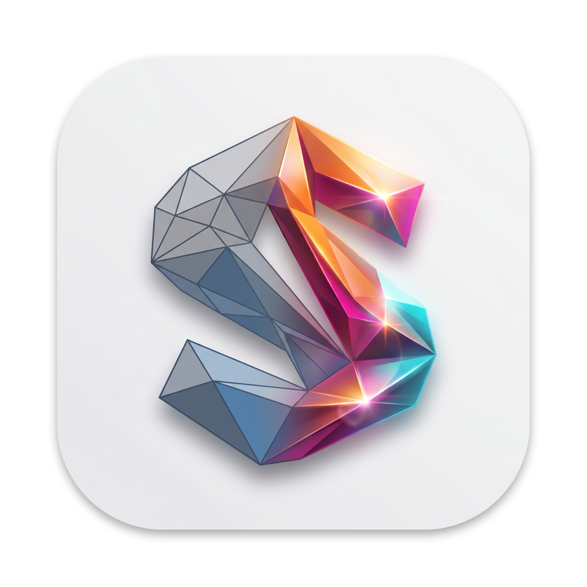

<p align="center"></p>

# MacShade

**The real [ReShade](https://reshade.me) 6.8 for macOS.** Same overlay, hotkeys, presets, screenshots, effects (`.fx`) and languages as on Windows —
packaged as a library that is injected into games, plus a SwiftUI launcher app that makes it easy to use.

> **Credit where it is due.** All the hard work — the shader compiler, the effect runtime, the overlay, the whole of ReShade — is by
> **Patrick Mours ([crosire](https://github.com/crosire))** and the ReShade contributors. MacShade only adds a thin macOS platform layer
> underneath the unmodified ReShade core and a launcher on top. It is an independent project, **not affiliated with or endorsed by ReShade**.
> If you like it, please support the original: <https://reshade.me> · <https://github.com/crosire/reshade>

-lightgrey) 

## What it does

- Runs ReShade in **native macOS games** (Apple Silicon): Vulkan (MoltenVK), OpenGL and Metal.
- **Launcher app**: add games by drag & drop or "Find games", pick a look (preset) per game, set start parameters, hotkeys, frame-rate limit — then press *Start with ReShade*.
- **Your game stays untouched.** The launcher makes an ad-hoc signed copy of the game (macOS' hardened runtime would block injection into the original) and starts that.
- **Presets per game**, each with an explanation of the active filters: *Mix* (fast), *Plus* (real bloom), *Max* (everything), *Retro* (CRT look) and more.
- **Good performance**: pipelined OpenGL/Metal bridge, idle bypass (no cost when no effect is active), own FPS counter, optional frame limiter.
- Optional **depth buffer** for effects like SSAO/DoF (Vulkan games; experimental for OpenGL/Metal).
- Launcher UI in 8 languages (en, de, fr, es, it, pt, ja, zh-Hans).

## How games are supported

| Graphics API of the game | How ReShade gets the frames | Depth buffer |
|---|---|---|
| Vulkan via MoltenVK (e.g. vkQuake, UZDoom) | ReShade hooks in directly (Vulkan loader emulation, dyld interposing) | yes |
| OpenGL (e.g. UT2004, UT99, ioquake3) | Bridge: frame → IOSurface → ReShade on a private Vulkan device → back | experimental |
| Metal (e.g. Quetoo / SDL_GPU) | Same bridge, tapped at `presentDrawable:` | experimental |

**Not supported:** Windows games through Wine/CrossOver/Whisky (Direct3D), x86_64-only or 32-bit games, games with a *statically linked* MoltenVK (e.g. Raze), VR.

**How do I know whether a game works?** When you add a game, the launcher inspects its executable (architectures, linked graphics libraries) and shows the graphics path or why it cannot work.
That is only a prediction. The proof is starting the game: the log tab shows `Initializing ReShade …` and the path used, and the overlay opens with your overlay key.
`work/check_games.sh` starts every game in the list and writes a report (`GAMES.md`).

Tested so far: vkQuake, UZDoom (Vulkan), UT2004, UT99 (OpenGL), Quetoo (Metal) — see [GAMES.md](GAMES.md).

## Using it

1. Build or download `MacShade.app` and start it.
2. Add a game (`.app`) with **+**, drag & drop, or **Find games**.
3. Choose a look on the **Look** tab, then press **Start with ReShade**.
4. In the game, press the overlay key (default `Home`, i.e. Fn + ←) to open the ReShade overlay. Tutorial on first start.
5. Your own effects: put a folder with `Shaders/` and `Textures/` into `~/Library/Application Support/MacShade/Collections/` (or use *Settings → Import shaders*).
   Per game, configuration, presets, log and screenshots live in `~/Library/Application Support/MacShade/Instances/<id>/`.

### Presets and costs

Measured on an Apple Silicon Mac, per frame of ReShade work (OpenGL bridge, UT2004 at about 2048×1280; larger windows cost more):

| Preset | What it does | Cost |
|---|---|---|
| *Look* (default), *Look-…* | MacLook: sharpening, bloom, vibrance, vignette in **one** pass | ~1–2 ms |
| *<Game>-Mix* | MacLook + CAS sharpening | ~2.5–4 ms |
| *<Game>-Plus* | Vibrance + qUINT bloom + CAS | ~4.5–8 ms |
| *<Game>-Max* | prod80 colour + bloom + Smart Sharp | ~8–16 ms |
| *<Game>-Retro* | pale colours, vignette, CRT scanlines | ~5–9 ms |

Every full-screen pass costs real time on the GPU, so more effects mean fewer FPS. The launcher's default look is deliberately a single pass.

## Building

Requirements: Xcode (Swift 5.9+), CMake, Python 3, [MoltenVK](https://github.com/KhronosGroup/MoltenVK) (`brew install molten-vk`).

```bash
# 1. third-party inputs (not part of this repo)
mkdir -p third_party && cd third_party
git clone --depth 1 https://github.com/KhronosGroup/Vulkan-Headers
git clone --depth 1 -b slim   https://github.com/crosire/reshade-shaders
git clone --depth 1 -b legacy https://github.com/crosire/reshade-shaders reshade-shaders-legacy
git clone --depth 1 https://github.com/martymcmodding/qUINT
git clone --depth 1 https://github.com/CeeJayDK/SweetFX
cd ..

# 2. the injected library
cd mac && mkdir -p build && cd build && cmake .. && make -j10      # libmacshade.dylib

# 3. the launcher app (bundles the dylib, MoltenVK and the effect collections)
cd ../../App && ./build_app.sh                                      # MacShade.app
```

## Repository layout

- `reshade/` – the ReShade 6.8 sources (BSD-3-Clause) with a few macOS patches, vendored without Git history. See `reshade/LICENSE.md`.
- `mac/platform/` – the macOS layer: start-up and paths, Vulkan loader emulation, input (NSEvent), OpenGL/Metal bridge, resources, localisation.
- `mac/compat/` – Win32 shims so the unmodified ReShade code compiles on macOS.
- `App/` – SwiftUI launcher (`Sources/`), presets, effect collections, translations (`gen_strings.py`).
- `work/`, `test_game.sh` – developer tools: window screenshots, simulated key/mouse events, per-effect cost measurements. They are tied to the author's setup (paths, game list) and are shown for reference.
- [NOTES.md](NOTES.md) – architecture notes and pitfalls.

## Debug environment variables

`MACSHADE_BASE`, `MACSHADE_TRACE`, `MACSHADE_LOG_STDERR`, `MACSHADE_TEST_KEYS=frame:vk,…`, `MACSHADE_CRASH_TRACE`, `MACSHADE_BRIDGE_DEBUG`, `MACSHADE_BRIDGE_STATS=1`,
`MACSHADE_DISABLE_GL_BRIDGE`, `MACSHADE_DISABLE_METAL_BRIDGE`, `MACSHADE_PIPELINE`, `MACSHADE_FPS_LIMIT`, `MACSHADE_NO_DEPTH`.

## Credits and licenses

MacShade stands on the work of many people. Thank you!

- **[ReShade](https://github.com/crosire/reshade)** by Patrick Mours (crosire) and contributors — the heart of everything here. BSD-3-Clause.
- **[reshade-shaders](https://github.com/crosire/reshade-shaders)** (standard and legacy effects) — crosire and the shader authors.
- **[qUINT](https://github.com/martymcmodding/qUINT)** — Marty McFly.
- **[SweetFX](https://github.com/CeeJayDK/SweetFX)** (CAS port, LumaSharpen, Vibrance, CRT, …) — CeeJay.dk and contributors.
- **[prod80 ReShade Repository](https://github.com/prod80/prod80-ReShade-Repository)** — prod80.
- **[AstrayFX](https://github.com/BlueSkyDefender/AstrayFX)** — BlueSkyDefender (shaders under CC BY-ND 4.0, shipped unmodified).
- **[OtisFX](https://github.com/FransBouma/OtisFX)** — Frans Bouma (Otis_Inf).
- **[MoltenVK](https://github.com/KhronosGroup/MoltenVK)** and **[Vulkan-Headers](https://github.com/KhronosGroup/Vulkan-Headers)** — Khronos Group / The Brenwill Workshop (Apache-2.0).
- Dear ImGui, stb, glad, fpng, and the other libraries under `reshade/deps/` — see their own licenses.

The effect collections shipped in `App/Resources/Collections/` keep their authors' licenses (see the `LICENSE` files in the respective folders, where the authors provide one).
The game icons shown in the launcher are read from the games installed on your Mac.

MacShade's own code (`mac/`, `App/Sources`, scripts) is released under the [BSD 3-Clause license](LICENSE), like ReShade itself.
